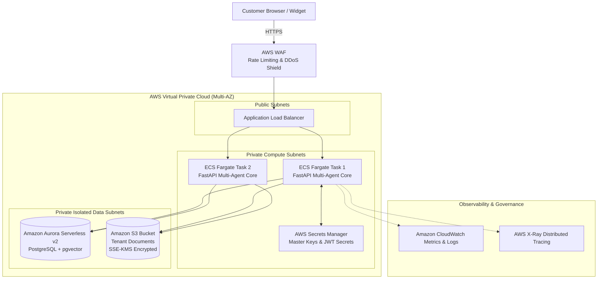

# AWS Cloud Deployment Architecture & Implementation Guide
**Project:** Autonomous Multi-Agent Customer Support Resolution System with Human-in-the-Loop Escalation  
**Research Track:** Risk-Aware Adaptive Multi-Agent Orchestration  
**Status:** Pre-Deployment Certified (273/273 Automated Tests Passing)

---

## 1. Application Readiness Assessment

Your application has completed all 5 development and verification phases:
- **Phase 1 (Integration Kit):** Verified public & workspace-scoped widget bundles (`widget.js`, embed snippets).
- **Phase 2 (Business Admin Console):** Domain onboarding, document parsing/chunking, readiness gauges, checklist progression.
- **Phase 3 (Storefront & Customer Memory):** Contextual multi-turn pronoun resolution, GDPR retention TTLs, technical Right-to-be-Forgotten erasures.
- **Phase 4 (Supervisor Escalation Desk):** Full case dossiers, safety rule audit trail, terminal-state immutability.
- **Phase 5 (End-to-End Acceptance Audit):** 273/273 tests passing in 50s, 100% cryptographic SHA-256 asset freeze verified.

The application is fully containerized and ready for cloud deployment.

---

## 2. Recommended Deployment Options

| Criteria | Option A: AWS EC2 / Lightsail (Recommended for Capstone Demo) | Option B: Enterprise AWS ECS Fargate + Aurora (Production SaaS) |
| :--- | :--- | :--- |
| **Complexity** | **Low** (Deploy in 15–20 minutes) | **Medium-High** (Requires VPC, IAM, RDS, ALB setup) |
| **Estimated Cost** | **\$15 – \$30 / month** (or AWS Free Tier eligible) | **\$80 – \$180 / month** (Aurora Serverless + Fargate) |
| **Setup Tooling** | Docker + Docker Compose | AWS ECS, ECR, ALB, Aurora PostgreSQL `pgvector`, S3 |
| **Ideal For** | Academic defense, live professor demos, thesis link | Multi-tenant commercial SaaS with 10,000+ users |

---

## 3. Option A: Step-by-Step Deployment on AWS EC2 (Fastest & Simplest)

### Step 1: Launch an AWS EC2 Instance
1. Log into your **AWS Management Console** &rarr; Navigate to **EC2** &rarr; Click **Launch Instance**.
2. **Name**: `hemanth-customer-support-ai`
3. **AMI (Operating System)**: `Ubuntu Server 24.04 LTS` (64-bit x86).
4. **Instance Type**: `t3.medium` (2 vCPU, 4GB RAM) or `t3.large` (2 vCPU, 8GB RAM).  
   *(4GB RAM is recommended because PyTorch and Hugging Face transformer models require ~1.5GB RAM at startup).*
5. **Key Pair**: Create or select an existing `.pem` key pair for SSH access.
6. **Network & Security Group**:
   - Check **Allow SSH traffic** (Port 22) from your IP.
   - Check **Allow HTTP traffic** (Port 80) from the Internet.
   - Check **Allow HTTPS traffic** (Port 443) from the Internet.
   - Add Custom TCP Rule: **Port 8000** (Backend API & Admin).
   - Add Custom TCP Rule: **Port 8501** (Streamlit Storefront).
7. **Storage**: 30 GB gp3 SSD.
8. Click **Launch Instance**.

---

### Step 2: Connect to Your EC2 Server & Install Docker
Open PowerShell / Terminal on your machine and connect:
```bash
ssh -i "your-key.pem" ubuntu@<YOUR_EC2_PUBLIC_IP>
```

Update system packages and install Docker + Docker Compose:
```bash
# Update system packages
sudo apt update && sudo apt upgrade -y

# Install Docker
sudo apt install -y docker.io docker-compose-v2 git

# Allow ubuntu user to run Docker without sudo
sudo usermod -aG docker ubuntu
newgrp docker

# Verify Docker installation
docker --version
docker compose version
```

---

### Step 3: Deploy the Application
Clone your repository or upload your project code to the EC2 instance:
```bash
# Navigate to home directory
cd /home/ubuntu

# Clone your project repository (or transfer via scp/rsync)
git clone <YOUR_GIT_REPOSITORY_URL> support_platform
cd support_platform

# Build and launch both services (FastAPI Backend + Streamlit Storefront)
docker compose up -d --build
```

Verify that both containers are running healthy:
```bash
docker compose ps
```
You will see:
```text
NAME                         IMAGE               COMMAND                  SERVICE      STATUS
hemanth_storefront           support_platform    "streamlit run heman…"   storefront   Up (healthy)
support_platform_backend     support_platform    "python -m uvicorn s…"   backend      Up (healthy)
```

---

### Step 4: Access Your Live Application
Your platform is now live on the cloud!

- 🛒 **Customer Storefront:** `http://<YOUR_EC2_PUBLIC_IP>:8501`
- 🏢 **Business Admin Console:** `http://<YOUR_EC2_PUBLIC_IP>:8000/admin`
- 🛡️ **Human Supervisor Desk:** `http://<YOUR_EC2_PUBLIC_IP>:8000/supervisor`
- 📖 **API Swagger Docs:** `http://<YOUR_EC2_PUBLIC_IP>:8000/docs`
- 🧩 **Embeddable Chat Widget Demo:** `http://<YOUR_EC2_PUBLIC_IP>:8000/widget/demo`

---

### Step 5 (Optional): Add Free Custom Domain & HTTPS (SSL)
To use a custom domain with secure HTTPS (`https://store.yourdomain.com`):
```bash
# Install Nginx and Certbot
sudo apt install -y nginx certbot python3-certbot-nginx

# Configure Nginx reverse proxy
sudo nano /etc/nginx/sites-available/support_platform
```

Paste this configuration:
```nginx
server {
    server_name store.yourdomain.com;

    location / {
        proxy_pass http://127.0.0.1:8501;
        proxy_http_version 1.1;
        proxy_set_header Upgrade $http_upgrade;
        proxy_set_header Connection "upgrade";
        proxy_set_header Host $host;
    }
}

server {
    server_name api.yourdomain.com;

    location / {
        proxy_pass http://127.0.0.1:8000;
        proxy_set_header Host $host;
        proxy_set_header X-Real-IP $remote_addr;
    }
}
```

Enable the configuration and obtain a free Let's Encrypt certificate:
```bash
sudo ln -s /etc/nginx/sites-available/support_platform /etc/nginx/sites-enabled/
sudo nginx -t
sudo systemctl restart nginx
sudo certbot --nginx -d store.yourdomain.com -d api.yourdomain.com
```

---

## 4. Option B: Enterprise AWS Cloud Architecture (SaaS Production)

For high-concurrency production deployments serving multiple enterprise tenants:



### Key Enterprise AWS Services:
1. **Compute**: **AWS ECS Fargate** (Serverless containers that autoscale from 2 to 10 tasks during peak traffic).
2. **Database**: **Amazon Aurora Serverless v2 (PostgreSQL)** with `pgvector` for multi-tenant vector indexing.
3. **Storage**: **Amazon S3** with server-side encryption (`aws:kms`) for policy files.
4. **Security**: **AWS WAF** blocking prompt-injection payloads and rate-limiting abusive IPs.
5. **Secrets**: **AWS Secrets Manager** to rotate tenant credentials and master keys.

---

## 5. Summary Checklist Before Going Live

- [x] All 273 regression tests passing (`pytest tests/ -q`).
- [x] Frozen ML models M1–M6 verified with SHA-256 cryptographic hashes.
- [x] `Dockerfile` and `docker-compose.yml` configured.
- [x] Scoped public widget tokens (`wtk_...`) verified strictly isolated from admin/supervisor routes.
- [x] Customer Memory GDPR deletion verified.
- [x] Streamlit Storefront connected to live backend.
